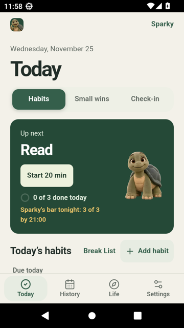

# Sparky

A habit tracker with a turtle who holds you to it.

Pick one to three habits. Every evening at 21:00 Sparky checks your day: everything done and he gives you a thumbs up, 70% or more is so-so, less than that and he is disappointed. He means it. Sparky is for people who really want to change their habits.

<p>
  
  
  
</p>

## What it does

- **Today:** your next habit, a one-tap start or timer, and tonight's bar ("Sparky's bar tonight: 3 of 4 by 21:00").
- **Evening check:** a notification at 21:00 with Sparky's verdict, even when the app is closed.
- **Small wins, check-ins, streaks** with freezes earned by full weeks, and planned rest days that don't count against you.
- **Focus sessions** that can turn on Do Not Disturb and always turn it off again.
- **History and reports** by day, week, month or year, plus optional phone screen time and Health Connect data.
- **Coach (optional):** connect your own ChatGPT plan to ask about your habits. Nothing is sent unless you connect it and choose to share.
- **Private by default:** your records stay on your phone. No account, no ads, no tracking. Export or back up whenever you like.

## Install

Download the latest APK from [Releases](../../releases) and open it on an Android phone (Android 9 or newer). Android will ask you to allow installs from your browser or file manager.

## Build from source

Requirements: Node.js 20+, JDK 17, Android SDK (compileSdk 36) and Gradle 8.11.

```sh
npm install
npm run build          # builds the web app into dist/
npm test               # unit tests
npm run test:browser   # browser tests (Playwright)
cd android
gradle :app:assembleRelease   # packages dist/ into the APK
```

The release APK is unsigned; sign it with your own key (`zipalign` then `apksigner sign`).

## Privacy and terms

See [docs/one-life-privacy.md](docs/one-life-privacy.md) and [docs/one-life-terms.md](docs/one-life-terms.md).
